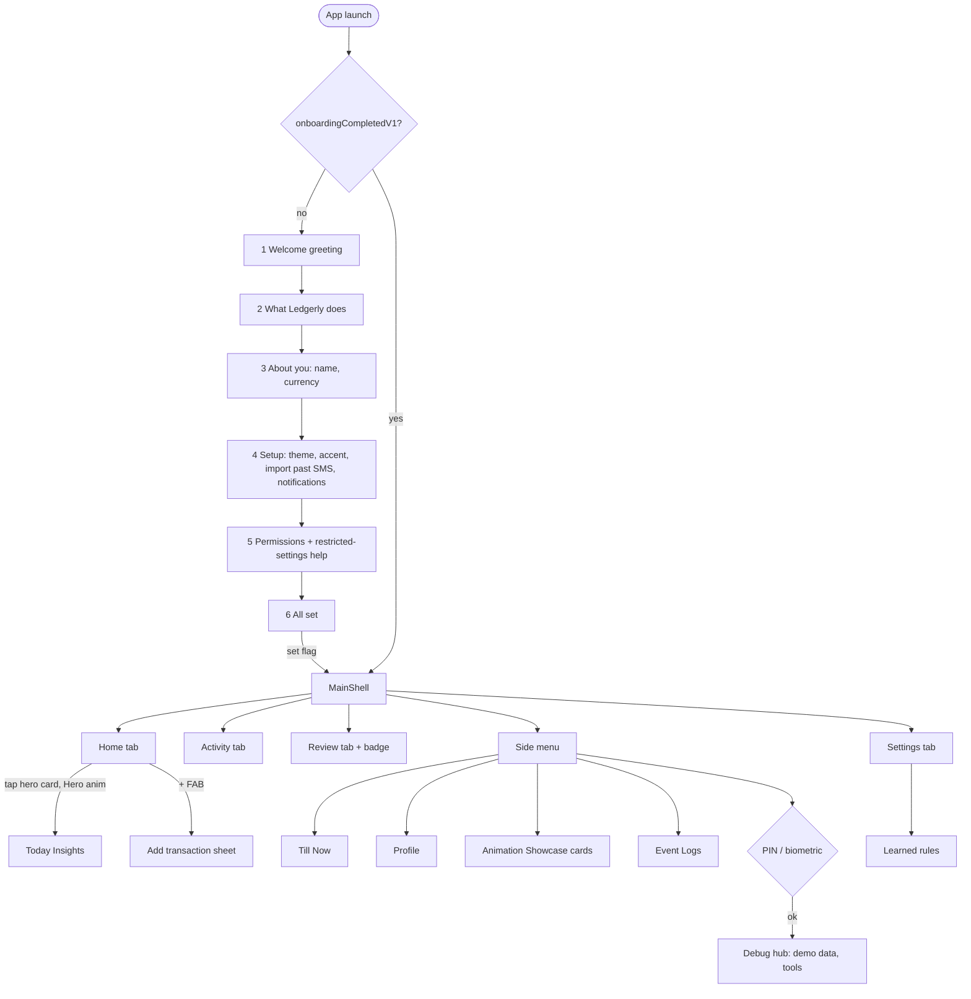
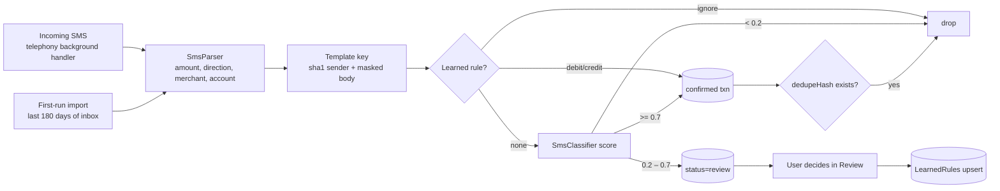
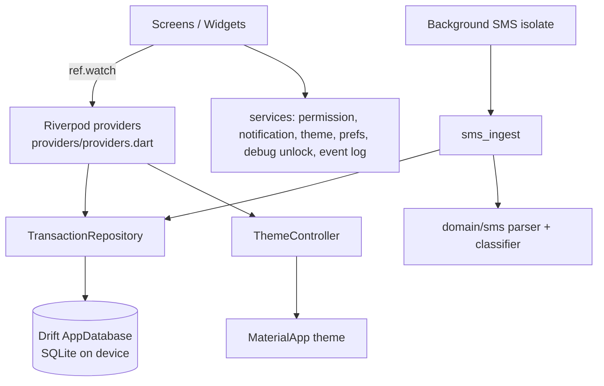

# Ledgerly — Functional Specification

Version: P13 (branch `feat/p13-handoff-docs`, stacked on PRs #1–#14). Platform: Android only.
Package: `com.abhranil.ledgerly`. Single user, offline-first, cloud sync planned.

## 1. Purpose

Ledgerly automatically turns bank / card / UPI SMS into a personal ledger so the user sees,
at a glance, **how much they spent today**, their income, and net balance — without typing.
Uncertain messages (offers, loan ads, OTP-like texts) are not guessed silently: they go to a
**Review** queue, and each decision teaches the app a rule for that message template.

Principles: on-device only (raw SMS never leaves the phone and is never logged), the user's
chosen theme and accent drive every screen, nothing in the UI is hidden behind build flags.

## 2. Navigation map

## 3. User flows

### 3.1 Onboarding (first run only) — `screens/onboarding/onboarding_flow.dart`
Six pages with progress indicator and Skip where safe:
1. **Welcome** – time-of-day greeting + Ledgerly icon.
2. **What Ledgerly does** – reads bank SMS, tracks spend/income, learns from review; data stays on device.
3. **About you** – name (used in greetings and Profile) and currency.
4. **Setup** – existing themes/accents only, "import past SMS" (180 days), notifications on/off. Note: all changeable later in Settings.
5. **Permissions** – SMS + notifications via `PermissionService`; shows restricted-settings help if denied.
6. **All set** – summary, then Home. Writes `onboardingCompletedV1=true`; past-SMS import runs if chosen.

Acceptance: onboarding never reappears after completion (until uninstall / data clear).

### 3.2 Home tab — `home_dashboard.dart`
Today's spend hero card, income and net balance, week & month mini-stats, recent transactions,
quick-add FAB (`widgets/add_transaction_sheet.dart`). Totals count only `status='confirmed'` rows.
Day rolls over at local midnight (`currentDayProvider`).

### 3.3 Today Insights — `today_insights_page.dart`
Opened by tapping the hero card (shared Hero animation). Shows spend by category and by hour,
comparison vs yesterday and vs average, and top transactions (`domain/summary/insights.dart`).

### 3.4 Activity tab — `history_page.dart`
All transactions with Day / Week / Month / All filter chips and search matching merchant,
note, sender or amount.

### 3.5 Review & learning — `review_queue_page.dart`, `learned_rules_page.dart`
Each review item offers **Debit / Credit / Ignore**. The decision:
- confirms or deletes that row, and
- upserts a `LearnedRules` row keyed on the message **template key** (sha1 of normalised sender + masked template), so future SMS with the same template are auto-classified.
Rules can be viewed and deleted in Settings → Learned rules. The Review tab shows a pending-count badge.

### 3.6 Settings tab — `comprehensive_settings_page.dart`
One page, jump buttons at the top, sections: **Appearance** (theme mode, accent, animation
style), **SMS & permissions** (status, request, open app settings, import past SMS),
**Learned rules**, **About**.

### 3.7 Side-menu screens
- **Till Now** (`till_now_page.dart`) – all-time totals and history.
- **Profile** (`profile_page.dart`) – name, currency, stats; no duplicated settings.
- **Animation Showcase** (`routes/animation_showcase.dart`) – expandable cards to preview and pick page-transition styles; visible to everyone.
- **Event Logs** (`event_logs_page.dart`) – app event log with filters (no SMS bodies).
- **Debug hub** (`debug_hub_page.dart`) – gated by a user-set PIN (salted SHA-256 in SharedPreferences) or device biometric (`local_auth`); unlock lasts for the app session. Contains demo-data tools (`demo_page.dart`).

## 4. SMS pipeline

- Accepts all senders (no allow-list); scoring uses past-tense money verbs, masked account
  numbers, reference numbers (+) and offer words / links (−). Thresholds: `acceptAt=0.7`, `dropBelow=0.2`.
- Dedupe: `dedupeHash` unique column prevents double inserts (background + import overlap).
- Entry point: `services/sms_ingest.dart#ingestSms` returns `IngestResult` counts.
- Background handler is a top-level `@pragma('vm:entry-point')` function in `main.dart`.

## 5. Data model (Drift, schema v2) — `data/db/tables.dart`

| Table | Key columns | Notes |
|---|---|---|
| `Transactions` (`TxnRow`) | `id` uuid PK, `amountMinor` (paise), `type` debit/credit, `source` sms/manual/migrated/import, `occurredAt` UTC ms, `rawBody`, `sender`, `merchant`, `note`, `dedupeHash` unique, `status` confirmed/review, `templateKey`, `confidence`, `deleted`, `syncStatus`, timestamps | soft delete + sync fields ready for cloud |
| `LearnedRules` (`RuleRow`) | `id` PK, `templateKey` unique, `sender`, `action` debit/credit/ignore, `sample` (masked) | no message text stored |

Migration v1→v2 adds review columns and `LearnedRules`. Legacy SharedPreferences data is migrated once (`data/migration/prefs_migration.dart`).
Non-DB prefs (SharedPreferences): onboarding flag, name, currency, notifications, import choice, theme, accent, animation style, debug PIN hash/salt.

## 6. Architecture & state

| Provider | Type | Purpose |
|---|---|---|
| `clockProvider` | Provider | injectable "now" for tests |
| `databaseProvider` / `transactionRepositoryProvider` | Provider | DB + repository singletons |
| `currentDayProvider` | StreamProvider | ticks at local midnight |
| `todayRangeProvider`, `weekRangeProvider`, `monthRangeProvider` | Provider | date ranges |
| `rangeTransactionsProvider` | StreamProvider.family | live rows in a range |
| `todayTransactionsProvider`, `allTransactionsProvider` | Provider / StreamProvider | lists |
| `todaySummaryProvider`, `weekSummaryProvider`, `monthSummaryProvider`, `allTimeSummaryProvider` | Provider | debit/credit/net |
| `themeControllerProvider` | NotifierProvider | theme mode + accent → `ColorScheme.fromSeed` |
| `reviewQueueProvider`, `learnedRulesProvider` | StreamProvider | review queue, rules |

## 7. Permissions
Declared: `READ_SMS`, `RECEIVE_SMS`, `POST_NOTIFICATIONS` (+ `USE_BIOMETRIC` via local_auth). Location/phone/SEND_SMS from the telephony plugin are removed in the manifest.
Sideloaded installs may hit Play Protect enhanced fraud protection (India) and Android 13+ restricted settings — see `docs/SIDELOAD_ANDROID.md`. Install with `adb install -r -g` for testing.

## 8. Privacy
- Raw SMS bodies are stored only in the local SQLite DB (`rawBody`) so parsing can be re-run; they are never sent off-device, never written to logs or Event Logs.
- Learned rules store only masked templates.
- No analytics, no network calls. Uninstall / clear data removes everything.

## 9. Build & release
- Debug: `flutter run -d <id>` or `flutter build apk --debug`.
- Release: `flutter build apk --release --split-per-abi`; signed with `android/key.properties` (gitignored) → falls back to debug key if absent.
- Toolchain: Gradle 8.14, AGP 8.11.1, Kotlin 2.2.20, JDK 17.
- Icons/splash: `flutter_launcher_icons` + `flutter_native_splash` from `assets/branding/`.
- CI: workflow drafted but not committed (token lacked `workflow` scope).

## 10. Testing
`flutter test` – unit (parser, classifier, ingest, summaries), data (repository, schema and prefs migrations), widget flows (onboarding, shell, settings sections, insights, search/theme, debug unlock). SMS fixtures in `test/fixtures/sms_samples.dart`. Real SMS receipt must be verified on a physical phone (emulator SMS is unreliable).

## 11. Known issues / open items
- `comprehensive_settings_page.dart` is ~1.3k lines; should be split per section.
- Services are static classes (`UserPrefsService`, `DebugUnlockService`, `PermissionService`) — harder to fake; move behind providers.
- `databaseProvider` wraps a global `appDatabase`; background isolate opens its own instance.
- Category breakdown in Insights is heuristic (merchant-based); no user-editable categories yet.
- Event log stores events in SharedPreferences; consider a Drift table.
- ~45 analyzer info-level lints remain (no errors/warnings).
- CI workflow not pushed.

## 12. Roadmap
1. Cloud sync (rows already carry `syncStatus`, soft delete, uuid ids, UTC times).
2. User categories and budgets.
3. Export (CSV) / backup.
4. Play Store internal testing track (avoids sideload restrictions; needs SMS permission declaration).
